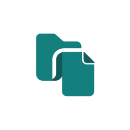
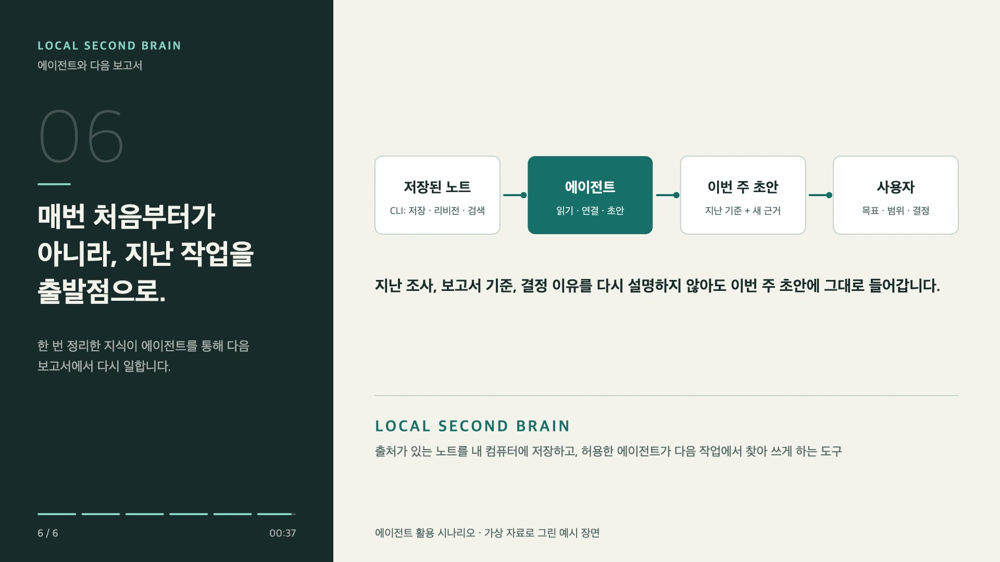
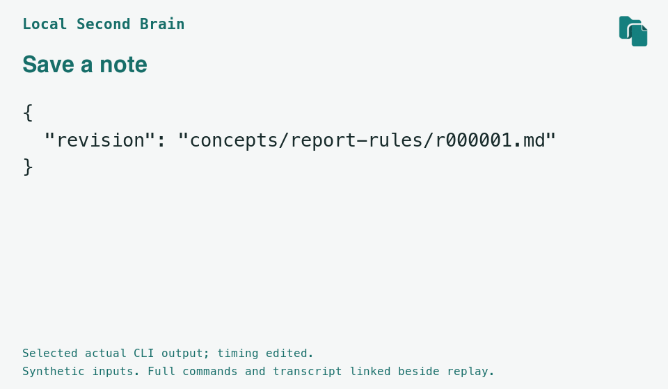

# Local Second Brain



[English](README.md) | **한국어**

## AI와 쌓은 지식, 대화 밖에서도 이어서.

**원문과 함께 남기고, 다음 작업에 다시 쓰는 나만의 지식 저장소.**

**AI에게 같은 배경을 매번 처음부터 설명하는 일을 줄이세요.**

유용한 프로젝트 규칙, 이전 조사 내용, 결정을 내린 이유를 출처가 있는 노트로 저장해 두세요. 다음 작업에서는 허용한 에이전트가 관련 노트를 찾아 읽고 새 자료와 함께 활용하며, 사용자는 목표를 정하고 결과를 검토합니다.

**다음 보고서를 쓸 때**

흩어진 자료를 다시 모으고 보고서 규칙을 다시 설명하는 대신, 에이전트에게 이번 주 초안을 요청하세요. 에이전트가 저장한 기준과 조사를 읽어 이번 주 자료와 합치고, 사용자는 달라진 내용만 검토합니다.

**멈췄던 프로젝트를 다시 시작할 때**

새 대화나 다른 에이전트에서도 배경을 처음부터 정리하는 대신, 저장한 결정과 그 이유를 가리켜 주고 거기서부터 이어서 작업하세요.

**이전 결론을 다시 살펴볼 때**

요약문 하나에 의존하거나 같은 원문을 다시 찾는 대신, 저장한 원문과 노트의 이전 버전을 열어 판단 근거를 살펴보고 바뀌어야 할 부분만 고치세요.

다음 작업을 시작할 때, 필요한 배경과 판단 기준이 이미 손에 있게 하세요.

[](https://indra622.github.io/local-second-brain/assets/agent-report-v2-ko.mp4)

[38초 자막 시나리오 보기](https://indra622.github.io/local-second-brain/?lang=ko#report-scenario) | [장면 설명과 자막](site/data/agent-report-v2-ko.txt). 가상 자료와 미리 작성한 초안입니다. 허용한 에이전트가 CLI로 저장된 노트를 찾아 초안을 씁니다.

Local Second Brain은 프로젝트 작업 규칙, 자료 조사 요약, 기술을 선택한 이유 같은
노트를 원문 파일과 함께 내 컴퓨터에 저장하는 도구입니다. 허용한 에이전트가 저장된
노트를 검색해 다음 작업에 활용하고, 사용자는 언제든 원문과 수정 전 내용을 확인할 수 있습니다.

**[에이전트에게 설치 맡기기 (For agents)](#에이전트에게-설치-맡기기-for-agents)** | **[직접 시작하기](#시작하기)**

**[브라우저에서 예제 살펴보기](https://indra622.github.io/local-second-brain/?lang=ko)**

저장된 노트를 읽고, 원문을 확인하고, 수정 전후를 브라우저에서 비교해 보세요.
미리 작성한 가상 자료로 도구가 저장하는 파일을 보여 주는 예제 페이지입니다.
제품의 그래픽 화면(GUI)이나 실시간 AI 대화는 아닙니다.



보고서 규칙을 저장하고 다시 찾은 뒤, 바뀐 내용과 비교하는 과정을 터미널에서 보여 줍니다.
미리 작성한 가상 자료로 실제 명령을 실행한 출력 중 일부입니다. AI 모델을 호출하지 않았으며,
재생 시간을 조정하고 임시 경로 표기를 통일했습니다. 전체 출력은 아래 링크에서 볼 수 있습니다.
[정지 이미지](site/assets/cli-poster.png) | [텍스트 출력](site/data/transcript.txt)

### 한 번 정리한 지식을 다시 쓰세요

예를 들어, 지난번에 정리한 ‘보고서 작성 규칙’을 노트로 저장해 둡니다.
새 보고서 초안을 에이전트에게 맡기면, 에이전트가 허용된 폴더에서 그 노트를 찾아
저장해 둔 규칙을 기준으로 작성합니다.

### 결론의 근거까지 함께 남기세요

조사 요약과 그때 참고한 원문 파일을 함께 보관합니다. 나중에 요약의 내용이
궁금하면 원문을 열어 대조할 수 있습니다. 노트를 수정할 때는 새 버전으로
저장하므로, 수정 전 내용과 지금 내용을 비교할 수 있습니다.

### AI를 바꿔도 파일은 내게 남습니다

노트는 Markdown 파일로, 수집한 원문은 당시 내용을 그대로 유지한 파일로
내 컴퓨터에 남습니다. 사용하는 AI 서비스를 바꿔도 이 파일들은 그대로 보관하고,
노트는 이 도구나 AI 계정 없이 일반 텍스트 편집기로 열어 볼 수 있습니다.

## 오늘 조사한 자료로, 다음 주 보고서를

이렇게 활용할 수 있습니다. 아래는 가상의 예입니다.

1. **오늘:** 보관할 조사 자료를 고르고, 나 또는 에이전트가 정리한 노트와 함께 저장합니다.
2. **다음 주:** 에이전트에게 보고서를 요청합니다. 에이전트가 그 노트를 찾아 보고서의 출발점으로 씁니다.
3. **내용이 달라졌을 때:** 보관한 원문을 다시 열고 새 근거를 확인한 뒤 노트를 수정해 저장합니다. 이전 버전도 남습니다.

## 이런 분에게 맞습니다

AI와 자료를 조사하고, 프로젝트의 방향을 정하고, 반복해서 보고서를 쓰면서
한 작업에서 얻은 지식을 다음 작업에도 쓰고 싶은 분을 위한 도구입니다.
현재는 터미널에 명령을 입력해 쓰는 명령줄 도구(CLI)이며 초기 알파 단계입니다.
무엇을 저장할지, 에이전트가 어느 폴더를 쓸지, 결과를 받아들일지는
사용자가 정합니다. 에이전트에게 설치를 맡기거나 아래 예제를 직접 따라 해 보세요.

## 에이전트에게 설치 맡기기 (For agents)

에이전트에게 설치와 검증을 맡기려면 아래 지시문을 그대로 전달하세요.
직접 설치하려면 아래 [시작하기](#시작하기)를 따라 해 보세요.

```text
https://github.com/indra622/local-second-brain.git 에서 Local Second Brain을 설치하고 검증해 줘.
새 작업 폴더에 복제하거나, 기존 체크아웃을 확인하고 사용자 변경을 덮어쓰지 않고 재사용해 줘.
먼저 저장소의 README와 지원 요건을 읽어 줘.
프로젝트 안에 .venv를 만들고 문서의 소스 설치 방법인 python -m pip install -e . 를 사용해 줘.
그 환경을 활성화한 뒤 second-brain --help를 확인하고, 체크아웃 폴더에서 README의 합성 예제를
실행해 줘. 지식 폴더는 별도로 새로 만든 임시 폴더를 사용해 줘.
체크아웃, CLI 실행 파일, 데모 폴더의 경로와 실행한 명령, 결과를 알려 줘.
범위는 설치와 합성 데모로 한정해 줘. 개인 vault를 훑거나 데이터를 업로드하거나
전역 설정을 바꾸거나 원격 설치 스크립트를 셸에 바로 넘겨 실행하지 마.
설치만으로 자동 기억이나 모델 연동이 생기는 것은 아니야.
```

CLI 자체는 내용을 업로드하지 않고 로컬에 저장하고 검색합니다. 다만 클라우드 에이전트에 접근을
허용하면, 그 에이전트가 읽은 노트와 원문, `recall` 출력이 해당 AI 서비스로 전송될 수 있습니다.
어떤 폴더를 허용할지와 어느 AI 서비스를 쓸지는 사용자가 정합니다. 로컬 저장이 AI의 추론까지
오프라인으로 이루어진다는 뜻은 아닙니다.

`human-reviewed`, `machine-confirmed`는 기록에 적힌 검토자에 따라 붙는 참고 표시입니다.
CLI가 검토자의 신원을 확인하거나 내용의 사실 여부를 검증한 것은 아닙니다. 검토 시각을 직접 지정해도
실제로 그때 검토했다는 증거가 되지는 않습니다.

이후 실제 노트를 다룰 때는 [에이전트 안내](docs/agent-kit.ko.md)와
[작업 흐름](workflows/AGENT-WORKFLOW.ko.md)을 따릅니다.

## 시작하기

초기 알파 단계입니다. macOS 또는 Linux의 쓰기 가능한 로컬 POSIX 파일시스템,
POSIX 셸, `venv`를 지원하는 Python 3.11 이상이 필요합니다.
CI는 macOS와 Ubuntu에서 Python 3.11과 3.14를 검사합니다.
다른 Linux 환경과 WSL은 별도 검증하지 않았으며 Windows는 지원하지 않습니다.

Git으로 소스를 받은 뒤 내려받은 프로젝트 폴더(체크아웃)로 이동하세요. 압축파일을 받았다면
압축을 풀고 `pyproject.toml`이 있는 폴더에서 터미널을 여세요.
PyPI 배포는 없습니다. 예제와 안내 문서는 소스에 포함되어 있습니다.

```text
git clone https://github.com/indra622/local-second-brain.git
cd local-second-brain
```

Python을 확인하고 `venv`로 가상환경을 만든 뒤 설치하세요. 가상환경은 이 프로젝트의
Python 패키지를 다른 프로젝트와 분리하는 폴더입니다. 설치 시 PyYAML과 빌드 도구를
내려받으려면 보통 인터넷이 필요합니다. AI 계정이나 API 키는 필요 없습니다.
Python이 3.11보다 낮거나 `venv`가 없으면 적합한 Python을 먼저 설치하세요.

```sh
python3 --version
python3 -m venv --help > /dev/null
python3 -m venv .venv
. .venv/bin/activate
python -m pip install -e .
```

앞서 소개한 보고서 규칙을 직접 저장하고 찾아보세요. 가상 팀의 금요일 보고서 규칙을
저장한 뒤, 정확한 영어 단어 `report`로 검색해 읽습니다.
[이어서 사용하기](docs/getting-started.ko.md)에서는 검토 기록을 남기고 목요일로 바뀐 규칙을 저장합니다.
**capture(원문 수집)**는 선택한 파일을 복사하고 출처를 기록합니다.
**curate(노트 저장)**는 미리 쓴 글을 원문에 연결해 저장합니다.
이 예제는 준비된 파일을 사용하며 두 명령 모두 글을 생성하지 않습니다.

지식 폴더는 코드 폴더 밖에 두세요. 다음 임시 폴더는 실행 후에도 남으므로 직접
살펴볼 수 있습니다. 아래에서 출력하는 `DEMO_DIR=...` 줄을 저장해 두세요.
이 값은 상위 폴더입니다. `init`이 출력하는 `/wiki`로 끝나는 지식 폴더 경로와 다릅니다.

```sh
DEMO_DIR="$(mktemp -d "${TMPDIR:-/tmp}/second-brain.XXXXXX")"
printf 'DEMO_DIR=%s\n' "$DEMO_DIR"
second-brain init "$DEMO_DIR/wiki"
second-brain capture "$DEMO_DIR/wiki" examples/inputs/report-memo-1.txt \
  --id report-memo-1 --actor human:demo --resource synthetic:report-memo-1
second-brain curate "$DEMO_DIR/wiki" report-rules \
  --body examples/inputs/report-v1.md --source report-memo-1 --actor prepared-fixture/1 \
  --title 'Report-writing rules' --stale-after '2030-01-01T00:00:00+00:00'
second-brain search "$DEMO_DIR/wiki" 'report' --now '2026-10-27T00:00:00+00:00'
second-brain check "$DEMO_DIR/wiki" --now '2026-10-27T00:00:00+00:00'
```
저장한 노트를 읽어 보세요.

```sh
second-brain show "$DEMO_DIR/wiki" report-rules --format text
```

검색하면 저장한 보고서 규칙을 찾을 수 있습니다. 인덱스가 선택한 현재 버전이지만,
아직 초안이며 검토 기록은 없습니다. 출력에서는 `concepts/report-rules/r000001.md`에
`current: true`, `status: draft`, `trust: unverified`로 표시합니다.

첫 `check`에서는 메타데이터 형식이나 링크의 문제, 재확인 기한이 지난 노트가 발견되지 않습니다.
결과는 `invalid: []`, `warnings: []`, `stale: []`, `concepts: 1`입니다.
이 검사는 사실 확인이 아닙니다. 지식 폴더의 `index.md`에서 노트 링크를 열 수도 있습니다.

## 지원 범위와 한계

- **작업은 사용자가 이끕니다.** 자동 기억, 모델을 통한 글 생성, 의미 검색은 없습니다. 미리 작성한 노트를 저장하고 정확한 단어로 검색합니다. GUI와 MCP 서버는 없으며 OKF의 일부만 구현합니다.
- **로컬에서 실행됩니다.** CLI는 실행 중 네트워크를 사용하지 않습니다. 외부 에이전트에는 각자의 네트워크 및 데이터 정책이 적용됩니다.
- **검토 기록은 선언입니다.** 검토 기록과 재확인 기한은 다시 확인할 대상을 고르는 단서이며, 검토자의 신원을 인증하거나 사실을 검증하지 않습니다. 자세한 내용은 [명령과 지원 범위](docs/reference.ko.md)를 참고하세요.
- **Obsidian은 선택 사항입니다.** [뷰어 안내](docs/getting-started.ko.md#obsidian이-있을-때)를 따라 열어 볼 수 있지만 GUI 작업 흐름은 검증하지 못했습니다. Obsidian 없이도 사용할 수 있습니다.

## 이어서 사용하기

- [검토, 수정, 다시 찾기](docs/getting-started.ko.md): 예제를 이어서 세 버전을 남기고 별도 합성 재사용 작업을 실행합니다. 선택 사항인 Obsidian 안내도 있습니다.
- [내 에이전트로 사용하기](docs/agent-kit.ko.md): 출처가 있는 노트를 쓰고 나중 작업에 재사용합니다. 파일 인터페이스는 특정 에이전트나 자동 연동을 요구하지 않습니다.
- [공개 자료로 실행한 Codex 검증](docs/field-validation.md): 실제 에이전트 작성과 후속 작업, 빈 검색 결과와 GUI 접근 한계를 기록했습니다. 한 번의 수동 실행이며 모든 에이전트의 연동 시험은 아닙니다.
- [명령과 지원 범위](docs/reference.ko.md): 정확한 검색 규칙, 검토 선언, 안전과 복구 한계. [개발과 검증](docs/development.ko.md)에는 테스트와 CI 설명이 있습니다.

이전 버전은 직접 고치지 말고 별도 파일에 수정한 뒤 `curate`로 저장하세요.
세부 규칙은 참조 문서에서 확인할 수 있습니다.

## 라이선스와 출처

이 프로젝트에서 직접 작성한 구현과 문서는 [MIT 라이선스](LICENSE)를 따릅니다.
저작권 표기는 `Copyright (c) 2026 indra622`입니다.

이 구현은 LLM Wiki의 작업 흐름과
[Open Knowledge Format(OKF) 명세](https://github.com/GoogleCloudPlatform/open-knowledge-format/blob/main/SPEC.md)를 참고했습니다.
이 개념과 제3자 자료의 출처는 각 작성자에게 있습니다. 제3자 코드, 문서와 수집한 원문에는
각각의 라이선스와 이용 조건이 적용됩니다. 이 프로젝트의 MIT 라이선스가 그 자료의
라이선스를 바꾸지는 않습니다.
