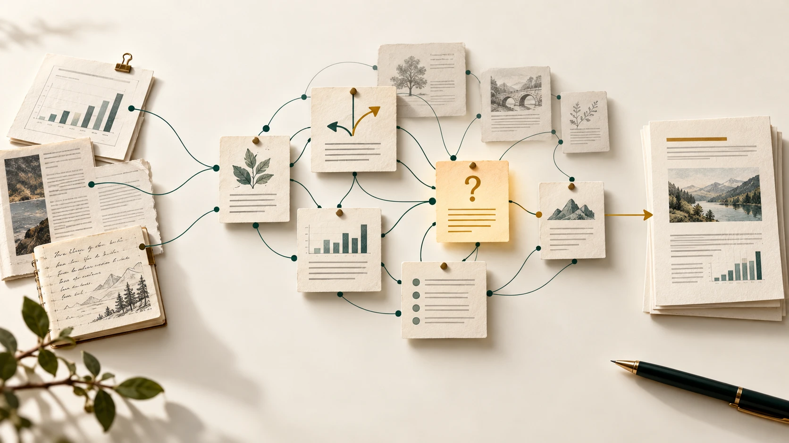

# Local Second Brain


**English** | [한국어](README.ko.md)

## Keep what you learn with AI. Use it beyond the chat.

**Your own knowledge library, with sources attached and notes ready to reuse.**

**The Second Brain we are building toward**



Past sources and decisions connect, so relevant knowledge can support today’s question and the next report or task.

A vision illustration, not a current product screen. Today, you save and search notes with a command-line tool and choose what to give your AI.

Local Second Brain stores notes such as project rules, research summaries, and reasons
for technical decisions on your computer, alongside their source files. Search for a saved
note and give it to your AI for the next task, or inspect its sources and earlier versions.

**[For agents](#for-agents)** | **[Manual quick start](#quick-start)**

**[Explore the browser sample](https://indra622.github.io/local-second-brain/)**

Explore saved notes, inspect their sources, and compare revisions in your browser.
This sample illustrates the files the tool saves, using prepared fictional notes.
It is a demonstration page, not a product GUI or live AI chat.


Watch a report rule get saved, found, and compared with an updated version in the terminal.
The recording shows selected output from actual command runs using prepared fictional text;
no AI model was called. Playback timing was edited and temporary paths were normalized.
The full transcript is linked below.
[Static poster](site/assets/cli-poster.png) | [Text transcript](site/data/transcript.txt)

### Put your knowledge to work again

For example, save the report-writing guidelines you worked out last time as a note.
When you ask your AI to draft a new report, find and provide that note, then ask it
to write according to the saved guidelines.

### Keep the evidence behind the answer

Keep a research summary with the source files you used. If you later want to check
the summary, open the saved source and compare it. Save an edited note as a new
revision so you can compare the previous text with the current version.

### Change your AI. Keep your files.

Notes stay on your computer as Markdown files; captured sources retain the content
saved at capture time. Keep these files even when you change AI services, and open
the notes in a plain text editor without this tool or an AI account.

## Today's research, next week's report

An illustrative example:

1. **Today:** Choose the research files worth keeping. Save them with a note you or your agent writes.
2. **Next week:** Find that note and ask your agent to use it as a starting point for a report.
3. **When something changes:** Reopen the saved sources, check the new evidence, and save an updated note. The earlier version stays available.

## Who it's for

For people who work with AI on research, project decisions, or recurring reports
and want to carry useful knowledge from one task to the next.
The current product is an early-alpha command-line tool (CLI), operated by typing commands
in a terminal. You choose the sources and direct the writing and reuse. Start with an agent or follow the manual example below.

## For agents

To have an agent install and verify the tool, give it this prompt. For manual setup,
follow [Quick start](#quick-start) below.

```text
Install and verify Local Second Brain from https://github.com/indra622/local-second-brain.git.
Clone into a new working folder, or inspect and reuse an existing checkout without
overwriting user changes. Read its README and supported requirements first.
Create a project-local .venv and use the documented source install: python -m pip install -e .
With that environment active, verify second-brain --help and run the README synthetic
quickstart from the checkout, using a separate new temporary knowledge folder.
Report the checkout, CLI executable, and demo folder paths, commands, and results.
Keep this task to installation and the synthetic demo: do not scan personal vaults,
upload data, change global configuration, or pipe remote installers into a shell.
Installation does not provide automatic memory or model integration.
```

For later work with your own notes, use the [portable agent kit](docs/agent-kit.md)
and its [workflow](workflows/AGENT-WORKFLOW.md).

## Quick start

Early alpha. Use Python 3.11+ with `venv`, a POSIX shell, and a writable local filesystem
on macOS or Linux. CI covers macOS and Ubuntu with Python 3.11 and 3.14. Other Linux
environments and WSL are not separately validated; Windows is unsupported.

Get the source with Git, then enter the downloaded project folder (the checkout).
If you downloaded an archive instead, extract it and open a terminal in the directory containing `pyproject.toml`.
There is no PyPI release. Examples and guides come with this source checkout.

```text
git clone https://github.com/indra622/local-second-brain.git
cd local-second-brain
```

Check Python, create a virtual environment with `venv` to keep this project's Python
packages separate, and install. Installation normally needs
internet access to download PyYAML and build tools. No AI account or API key is required.
If Python is older than 3.11 or lacks `venv`, install a suitable interpreter first.

```sh
python3 --version
python3 -m venv --help > /dev/null
python3 -m venv .venv
. .venv/bin/activate
python -m pip install -e .
```

Try the report-rule workflow described above: save a fictional team's Friday report
rule, find it with the exact English word `report`, and read it back. In the
[continuation](docs/getting-started.md), you will record a review and save a Thursday update.
**Capture** copies a selected source and records its origin. **Curate** saves a note
you have already written, linked to that source. Both commands use prepared files here;
neither generates text.

Keep the knowledge folder outside the checkout. The following temporary folder remains
on disk so you can inspect it. Save the `DEMO_DIR=...` line printed below. It is the
parent directory; `init` prints the separate knowledge-folder path ending in `/wiki`.

```sh
DEMO_DIR="$(mktemp -d "${TMPDIR:-/tmp}/second-brain.XXXXXX")"
printf 'DEMO_DIR=%s\n' "$DEMO_DIR"
second-brain init "$DEMO_DIR/wiki"
second-brain capture "$DEMO_DIR/wiki" examples/inputs/report-memo-1.txt \
  --id report-memo-1 --actor human:demo --resource synthetic:report-memo-1
second-brain curate "$DEMO_DIR/wiki" report-rules \
  --body examples/inputs/report-v1.md --source report-memo-1 --actor prepared-fixture/1 \
  --title 'Report-writing rules' --stale-after '2030-01-01T00:00:00+00:00'
second-brain search "$DEMO_DIR/wiki" 'report' --now '2026-10-27T00:00:00+00:00'
second-brain check "$DEMO_DIR/wiki" --now '2026-10-27T00:00:00+00:00'
```
Read the saved note:

```sh
second-brain show "$DEMO_DIR/wiki" report-rules --format text
```

The search finds the saved report rule. It is the version selected in the index,
but it is still a draft with no recorded review. The output expresses this as
`current: true`, `status: draft`, and `trust: unverified` for
`concepts/report-rules/r000001.md`.

The first `check` finds no structural metadata or link problems and no notes past
their recheck date: `invalid: []`, `warnings: []`, `stale: []`, and `concepts: 1`.
It does not check facts. Open the knowledge folder's `index.md` to follow its link to the note.

## Scope and limits

- **You guide the work.** There is no automatic memory, model-generated synthesis, or semantic search. The tool stores prepared notes and searches exact words. It has no GUI or MCP server and implements only part of OKF.
- **Local operation.** The CLI does not use the network at runtime. External agents have their own network and data policies.
- **Review is a declaration.** Review records and freshness signals help you choose what to recheck; they do not authenticate reviewers or verify facts. See the [command and support reference](docs/reference.md).
- **Optional Obsidian viewing.** You can follow the [viewer instructions](docs/getting-started.md#with-obsidian), but the GUI workflow has not been verified. Obsidian is not required.

## Continue

- [Review, revise, and recall](docs/getting-started.md): continue this example, keep three revisions, and run a separate synthetic reuse task. Includes optional Obsidian instructions.
- [Use your own agent](docs/agent-kit.md): prepare sourced notes and reuse them in later work. The file interface does not require a particular agent or automatic integration.
- [Public-source Codex validation](docs/field-validation.md) (Korean): an actual agent-written note and follow-up task, with search misses and a GUI access limit. This is one manual run, not an integration test for every agent.
- [Command and support reference](docs/reference.md): exact search rules, review declarations, safety and recovery limits. [Developer checks](docs/development.md) describes tests and CI.

Keep original revisions intact: prepare changes in a separate file and save them with
`curate`. Detailed contracts are in the reference.

## License and attribution

This project's original implementation and documentation are licensed under the
[MIT License](LICENSE). Copyright (c) 2026 indra622.

The implementation draws on LLM Wiki workflow concepts and the
[Open Knowledge Format (OKF) specification](https://github.com/GoogleCloudPlatform/open-knowledge-format/blob/main/SPEC.md).
Those concepts and third-party materials remain attributed to their respective authors.
Third-party code, documentation, and captured source materials retain their own licenses
and terms; this project's MIT license does not relicense them.
